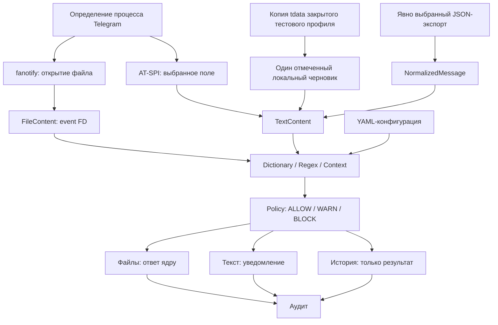

# Архитектура Linux endpoint-DLP

Актуальное состояние на 5 ноября 2026: endpoint-агенты в DEB/systemd,
центральный сервер текущего стенда — в Docker. [Эксплуатация](OPERATIONS.md),
[Docker и адреса действующего сервера](DOCKER.md#текущий-стенд-после-переноса).

## Действующая схема

| Уровень | Компоненты и взаимодействие |
| --- | --- |
| Файловая защита | `native/filesystem_launcher.c` → привилегированный fanotify broker → непривилегированный Python worker → ответ ALLOW/DENY; Telegram и Signal выбираются по UID и executable |
| Область файлов | Локальные файловые системы с явными исключениями; новые монтирования требуют перезапуска; это шире раннего watch-каталога |
| Анализ | `analysis.py`, `policy.py`: словари, регулярные выражения, контекст, правила чувствительных значений; `ml_classifier.py` и обученная модель — дополнительные WARN |
| Документы | `documents.py`, `document_worker.py`: ограниченное извлечение текста PDF/DOCX; OCR не реализован |
| Текстовые поля | `accessibility.py`, `text_monitor.py`: AT-SPI выбранного тестового поля Telegram/Signal, уведомление и журнал без запрета отправки |
| Локальные данные | Telegram: исследованные черновики/метаданные и отдельно JSON-экспорт; Signal: выбранные тексты из копии SQLCipher-базы закрытого клиента со штатным доступом к ключу |
| Системный агент | `dlp-lab-files.service` — файловая защита; `dlp-lab-forwarder.service` — выборка journald, минимизация, дисковая очередь и доставка |
| Пользовательские модули | `service.py` управляет отдельными user units для текстовых/локальных задач; они требуют графического сеанса и отдельной настройки |
| Сервер | `central.py`, SQLite, индивидуальные credentials и bounded remote diagnostics; два Docker listener-а текущего стенда используют общую базу |
| Панели | Центральная 8766: устройства, журнал, фильтры, диагностика. Локальная 8765: лабораторные модули и настройки; не заменяет управление пакетной файловой службой |

Поток события: мессенджер → endpoint-анализ → локальный журнал → forwarder →
центральный сервер → панель администратора. Анализ содержимого и файловый запрет
выполняются на рабочей машине; сервер не должен получать исходные сообщения.
При недоступности сервера локальная защита продолжает работать, отправщик хранит
очередь в пределах предусмотренного лимита. Решение BLOCK анализатора отдельно
от фактического DENY; событие открытия не доказывает отправку файла.

На текущем стенде контейнеры local/https работают с host network, без capabilities,
под UID 10001 и с read-only rootfs. Запись разрешена в базу и временный каталог.
Системные central-службы отключены, агенты продолжают работу в systemd.
Удалённое администрирование сейчас ограничено чтением диагностики: обновление
агентов и применение политик с сервера не реализованы.

## Исторический снимок архитектуры на 9 октября 2026

Ниже сохранено описание раннего этапа для воспроизводимости исследования.
Его watch-каталог, состав модулей и планы не описывают текущее развёртывание.

Актуально на 2026-10-09. Исследовательский модульный агент для Linux: три направления
данных используют общий анализатор и политику. Возможность обнаружить нарушение
и возможность остановить операцию — разные свойства системы.

## Три направления

| Направление | Сбор и нормализация | Анализ и действие | Проверено |
|---|---|---|---|
| Файлы | fanotify event FD → FileContent; фильтр Telegram по process identity | Dictionary/Regex/Context → ALLOW/WARN/BLOCK → FAN_ALLOW/FAN_DENY | Kernel test и ручное прикрепление тестовых файлов Telegram |
| Ввод | AT-SPI, одно поле с явно заданным маркером → TextContent | Те же правила → аудит/уведомление, observe_only | Реальный черновик Telegram, смена BLOCK/ALLOW |
| История | Явный JSON-экспорт одного чата → NormalizedMessage → TextContent | Те же правила → исторический аудит, enforcement=none | Два реальных экспорта; текст и подпись |
| Локальное хранилище | Разрешённая обработка локального ключа и временной копии tdata → один отмеченный черновик → TextContent | Те же правила → аудит, enforcement=none | Реальное чтение черновика закрытого Telegram; FF06/writer 7002008; не полная история |

## Компоненты и контракты

- `processes.py`: UID, PID/starttime, путь executable, device/inode. В режиме
  messengers анализируются настроенные процессы; это не аттестация бинарника.
  Telegram включён, eXpress — отключённый каркас без проверенной сборки.
- `fanotify.py`: event FD читается без повторного открытия пути. Наблюдаются только
  непосредственные дети `/var/lib/dlp-lab/watch`. `correlation.py` группирует open
  за 5 секунд с ограниченным числом ключей; анализ повторяется для каждого open.
- `accessibility.py`, `text_monitor.py`: привязка к одному видимому editable полю,
  исключение password, опрос каждые 300 мс. При утрате поля наблюдение завершается;
  автоматического выбора другого поля нет. Глобальные клавиатурные хуки отсутствуют.
- `telegram_export.py`: ограниченное чтение явно указанного JSON, нормализация
  text-array без добавления разделителей. Неизвестные account/recipient — None.
  Никаких обращений к ключам, сети или содержимому вложений.
- `analysis.py`, `policy.py`: общий анализ и числовая политика. `models.py` и
  `interfaces.py` содержат модели и контракты расширений. ML — интерфейс, не модель.
- `audit.py`: JSON Lines, UTC timestamp события, решение и метаданные без исходного
  текста. Offset относится к нормализованному тексту. Пути файлов могут быть чувствительны.
- `service.py`: пользовательский systemd запускает отдельные процессы модулей;
  общий просмотр journal. Это управление жизненным циклом, не новый анализатор.

Ядро не зависит от GUI-фреймворка мессенджера. AT-SPI импортируется только при
запуске соответствующего адаптера. Python >=3.11, C11 для fanotify setup, PyYAML
для политики. Анализ выполняется в главном потоке отдельного процесса (SIGALRM).

## Политика

`score = Σ weight[analyzer] × severity × confidence`, одно слагаемое на rule_id.
Ниже warn — ALLOW, от warn до block — WARN, от block — BLOCK. Confidence=1 для
детерминированного совпадения не означает вероятность утечки 100%.
Dictionary ищет подстроки, Regex — шаблоны, Context — термин и контекст в окне.
Правила эвристические: качество требуется оценивать на размеченном корпусе.

UTF-8 текст/обычный файл ограничены размером и временем. Ошибка → complete=false
и on_error (по умолчанию BLOCK). Нет извлечения PDF/Office/архивов/OCR.
Экспорт ограничен 16 MiB/10 000 записей, анализирует только text обычных сообщений.
Служебные и пустые записи учитываются как пропуски; содержимое вложений не проверяется.
Код выхода 0 у анализа означает завершение, а не решение ALLOW.

## Привилегии и выполнение

Root-owned фиксированный gateway создаёт fanotify group/mark, сбрасывает все
UID/GID и дополнительные группы, включает no_new_privs, затем исполняет Python
от roman. Sudo разрешает только установленный gateway без аргументов. Пользовательский
systemd запускает `sudo -n` именно для него; новых sudoers-прав и root-Python нет.
Пути и политика gateway фиксированы установкой; для файлов нельзя подменить --policy.

Ответ по файлу отправляется до записи аудита. WARN разрешает открытие, BLOCK
отказывает. При смерти worker/закрытии group ожидающие операции освобождаются:
fail-open. Защита не распространяется на уже открытые FD, файлы вне каталога,
подкаталоги, альтернативные каналы и последующее изменение файла.
`file_access_attempt` не доказывает намерение отправки: send_confirmed=false.

## Управляемый запуск

Три фиксированных transient user units: dlp-lab-files, dlp-lab-text, dlp-lab-export.
Команды: `scripts/dlp agent start files`, `start text --marker ...`, `stop`, `status`,
`logs`, `export --file ...`. Systemd обеспечивает единственный управляемый запуск
каждого компонента и остановку его cgroup. При ошибке процесс не перезапускается
автоматически. Новый явный start сбрасывает failed unit. История ошибок остаётся в journal.

Статус показывает жизнь процесса, а не полноту защиты. Начало готового файлового
монитора подтверждается monitor_started; привязка текста — text_monitor_started.
До привязки текстовый процесс может ждать 30 секунд. MainPID файловой службы может
принадлежать sudo, PID worker указан в событии. Ручные запуски вне user units
не управляются и не перечисляются командой status. Не смешивать оба способа запуска.

Journal объединяет stdout/stderr трёх модулей и сообщения systemd. Прямые команды
analyze/analyze-export/text-monitor остаются доступными и печатают в терминал.
Общий журнал относится только к запускам через agent. Права, срок хранения,
ротация и rate limiting определяются journald хоста; гарантии доставки/неизменности
не реализованы. Имя тестового маркера и служебные метаданные могут попасть в журнал.
Не использовать секрет в качестве маркера.

Автозапуск, linger, системные unit-файлы и новые зависимости не устанавливаются.
После logout поведение зависит от user manager хоста. Пользователь может остановить
свой агент и изменить доступные ему конфигурации: защиты от намеренного обхода нет.

## Доказательства и следующие этапы

Исследования и ограничения: [контекст](PROJECT_CONTEXT.md),
[файлы](research/telegram_process.md), [экспорт](research/telegram_export.md),
[send veto](decisions/004-text-send-enforcement.md),
[управление](decisions/006-agent-lifecycle.md), [демонстрация](demo.md).

Далее: измерение качества/задержек, расширение файлового покрытия, eXpress на
собственной тестовой среде, управление политикой администратором, надёжный аудит,
выбор свободной лицензии. Штатного синхронного veto через изученные AT-SPI API нет;
интеграция в иной клиент требует отдельного согласования.
